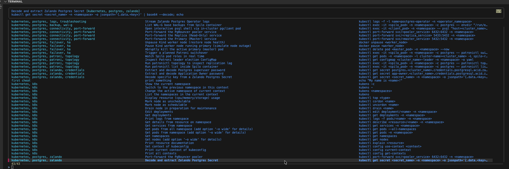

## Automatization and e2e tests

### Automate daily tasks

By exploring more the world of operations I could see that a good way of automatizing what we have is using the tool Navi.
As you can see in the image bellow we drop all the CLI commands and start favouring a well explained menu with total description of the operations that are done in k8s.
Also, on top of that for a different visibility and debugging we can also use UI friendly tools as K9s and Freelens.



Besides the usage of Navi as a user-friendly K8S and Docker - more as a command line tool, we would opt for a justfile to automatize most of the execution. This justfile can also support with execution during the CI.

The main idea of tests and automation is that we can have tests in the CI running e2e - if they pass with the new configuration of a PR, this PR is merged.
This will ensure that each deployment will be safe for the changes.


Using the justfile in this repo we have an automated reproducible lab environment:

```bash
mateus.desouza@SDGESP-6YGQ97WG zalando-postgres-operator-lab % just up   
kind get clusters | grep -qx pg-lab || kind create cluster --config lab-manifests/kind-config.yaml
[ -d postgres-operator ] || git clone --depth 1 --branch v2.0.1 https://github.com/zalando/postgres-operator.git
helm upgrade --install postgres-operator ./postgres-operator/charts/postgres-operator -n postgres-operator --create-namespace --wait
Release "postgres-operator" has been upgraded. Happy Helming!
NAME: postgres-operator
LAST DEPLOYED: Wed Nov 11 11:15:27 2026
NAMESPACE: postgres-operator
STATUS: deployed
REVISION: 3
DESCRIPTION: Upgrade complete
TEST SUITE: None
NOTES:
To verify that postgres-operator has started, run:

  kubectl --namespace=postgres-operator get pods -l "app.kubernetes.io/name=postgres-operator"
kubectl apply -n default -f lab-manifests/acid-demo.yaml
postgresql.acid.zalan.do/acid-demo configured
just wait-ready
kubectl wait -n default postgresql/acid-demo --for=jsonpath='{.status.PostgresClusterStatus}'=Running --timeout=10m
postgresql.acid.zalan.do/acid-demo condition met
kubectl wait -n default pod -l cluster-name=acid-demo --for=condition=Ready --timeout=10m
pod/acid-demo-0 condition met
pod/acid-demo-1 condition met
pod/acid-demo-2 condition met
pod/acid-demo-pooler-6844d678c9-c47qs condition met
pod/acid-demo-pooler-6844d678c9-dpvc8 condition met
kubectl get pod pgclient -n default >/dev/null 2>&1 || kubectl run pgclient -n default --image=postgres:17 --restart=Never --overrides='{"spec":{"nodeName":"pg-lab-control-plane","tolerations":[{"operator":"Exists"}]}}' -- sleep infinity
kubectl wait -n default pod/pgclient --for=condition=Ready --timeout=3m
pod/pgclient condition met
kubectl exec -i -n default pgclient -- bash -c 'cat > /tmp/loop.sh' < scripts/loop.sh
Lab ready. Next: just status / just drills
mateus.desouza@SDGESP-6YGQ97WG zalando-postgres-operator-lab % just status
kubectl get pods -n default -l cluster-name=acid-demo -L spilo-role -o wide
NAME                                READY   STATUS    RESTARTS   AGE     IP            NODE             NOMINATED NODE   READINESS GATES   SPILO-ROLE
acid-demo-0                         2/2     Running   0          23h     10.244.2.14   pg-lab-worker    <none>           <none>            master
acid-demo-1                         2/2     Running   0          5d19h   10.244.3.8    pg-lab-worker2   <none>           <none>            replica
acid-demo-2                         2/2     Running   0          5d19h   10.244.1.9    pg-lab-worker3   <none>           <none>            replica
acid-demo-pooler-6844d678c9-c47qs   1/1     Running   0          6d20h   10.244.1.6    pg-lab-worker3   <none>           <none>            master
acid-demo-pooler-6844d678c9-dpvc8   1/1     Running   0          6d20h   10.244.3.5    pg-lab-worker2   <none>           <none>            master
kubectl exec -n default "$(kubectl get pods -n default -l cluster-name=acid-demo,spilo-role=master -o jsonpath='{.items[0].metadata.name}')" -c postgres -- patronictl list
+ Cluster: acid-demo (7703934128535535679) -------+----+-------------+-----+------------+-----+
| Member      | Host        | Role    | State     | TL | Receive LSN | Lag | Replay LSN | Lag |
+-------------+-------------+---------+-----------+----+-------------+-----+------------+-----+
| acid-demo-0 | 10.244.2.14 | Leader  | running   | 19 |             |     |            |     |
| acid-demo-1 | 10.244.3.8  | Replica | streaming | 19 |  3/9C000060 |   0 | 3/9C000060 |   0 |
| acid-demo-2 | 10.244.1.9  | Replica | streaming | 19 |  3/9C000060 |   0 | 3/9C000060 |   0 |
+-------------+-------------+---------+-----------+----+-------------+-----+------------+-----+
mateus.desouza@SDGESP-6YGQ97WG zalando-postgres-operator-lab % 
```

We can also execute all our drills in an automated manner:

```bash
mateus.desouza@SDGESP-6YGQ97WG zalando-postgres-operator-lab % just status
kubectl get pods -n default -l cluster-name=acid-demo -L spilo-role -o wide
NAME                                READY   STATUS    RESTARTS   AGE     IP            NODE             NOMINATED NODE   READINESS GATES   SPILO-ROLE
acid-demo-0                         2/2     Running   0          23h     10.244.2.14   pg-lab-worker    <none>           <none>            master
acid-demo-1                         2/2     Running   0          5d19h   10.244.3.8    pg-lab-worker2   <none>           <none>            replica
acid-demo-2                         2/2     Running   0          5d19h   10.244.1.9    pg-lab-worker3   <none>           <none>            replica
acid-demo-pooler-6844d678c9-c47qs   1/1     Running   0          6d20h   10.244.1.6    pg-lab-worker3   <none>           <none>            master
acid-demo-pooler-6844d678c9-dpvc8   1/1     Running   0          6d20h   10.244.3.5    pg-lab-worker2   <none>           <none>            master
kubectl exec -n default "$(kubectl get pods -n default -l cluster-name=acid-demo,spilo-role=master -o jsonpath='{.items[0].metadata.name}')" -c postgres -- patronictl list
+ Cluster: acid-demo (7703934128535535679) -------+----+-------------+-----+------------+-----+
| Member      | Host        | Role    | State     | TL | Receive LSN | Lag | Replay LSN | Lag |
+-------------+-------------+---------+-----------+----+-------------+-----+------------+-----+
| acid-demo-0 | 10.244.2.14 | Leader  | running   | 19 |             |     |            |     |
| acid-demo-1 | 10.244.3.8  | Replica | streaming | 19 |  3/9C000060 |   0 | 3/9C000060 |   0 |
| acid-demo-2 | 10.244.1.9  | Replica | streaming | 19 |  3/9C000060 |   0 | 3/9C000060 |   0 |
+-------------+-------------+---------+-----------+----+-------------+-----+------------+-----+
mateus.desouza@SDGESP-6YGQ97WG zalando-postgres-operator-lab % just drills
NOTICE:  relation "ticks" already exists, skipping
kubectl exec -n default pgclient -- bash -c 'kill $(cat /tmp/loop.pid 2>/dev/null) 2>/dev/null || true'
probe writing to acid-demo - follow it with: just probe-log
just drill-switchover
10:17:34 switchover away from acid-demo-0
Current cluster topology
+ Cluster: acid-demo (7703934128535535679) -------+----+-------------+-----+------------+-----+
| Member      | Host        | Role    | State     | TL | Receive LSN | Lag | Replay LSN | Lag |
+-------------+-------------+---------+-----------+----+-------------+-----+------------+-----+
| acid-demo-0 | 10.244.2.14 | Leader  | running   | 19 |             |     |            |     |
| acid-demo-1 | 10.244.3.8  | Replica | streaming | 19 |  3/9C000060 |   0 | 3/9C000060 |   0 |
| acid-demo-2 | 10.244.1.9  | Replica | streaming | 19 |  3/9C000060 |   0 | 3/9C000060 |   0 |
+-------------+-------------+---------+-----------+----+-------------+-----+------------+-----+
2026-11-11 10:17:37.14169 Successfully switched over to "acid-demo-1"
+ Cluster: acid-demo (7703934128535535679) -----------------+----+-------------+-----+------------+-----+
| Member      | Host        | Role    | State               | TL | Receive LSN | Lag | Replay LSN | Lag |
+-------------+-------------+---------+---------------------+----+-------------+-----+------------+-----+
| acid-demo-0 | 10.244.2.14 | Replica | stopped             |    |     unknown |     |    unknown |     |
| acid-demo-1 | 10.244.3.8  | Leader  | running             | 19 |             |     |            |     |
| acid-demo-2 | 10.244.1.9  | Replica | in archive recovery | 19 |  3/9D0000A0 |   0 | 3/9D0000A0 |   0 |
+-------------+-------------+---------+---------------------+----+-------------+-----+------------+-----+
10:17:37 new leader: acid-demo-1 (after ~1s)
sleep 15
just drill-pod-delete
10:17:52 deleting primary pod acid-demo-1
pod "acid-demo-1" deleted from default namespace
10:17:55 new leader: acid-demo-0 (after ~3s)
just wait-ready
kubectl wait -n default postgresql/acid-demo --for=jsonpath='{.status.PostgresClusterStatus}'=Running --timeout=10m
postgresql.acid.zalan.do/acid-demo condition met
kubectl wait -n default pod -l cluster-name=acid-demo --for=condition=Ready --timeout=10m
pod/acid-demo-0 condition met
pod/acid-demo-1 condition met
pod/acid-demo-2 condition met
pod/acid-demo-pooler-6844d678c9-c47qs condition met
pod/acid-demo-pooler-6844d678c9-dpvc8 condition met
sleep 15
```


With this implemented we have different failover scenarious and cluster operations being executed automatically without manual intervention - if needed we can also implement recurrent reports within the CI stage to see how the changes in a PR will impact the deployment of the new instances using a similar framework.

This here is limited in quality because of the lack of time for keep with the development - but the bases for a reliable end-2-end test framework and operational workflows being done effortless are stated in this document.