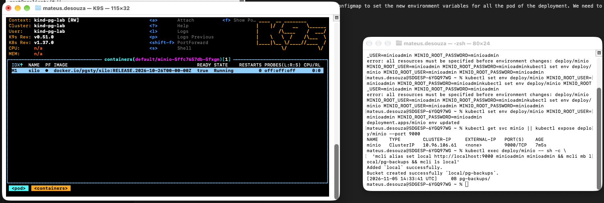
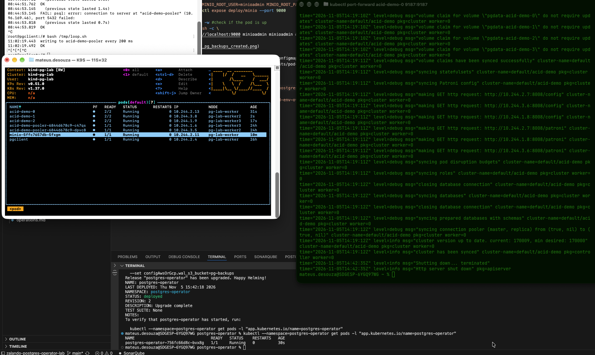
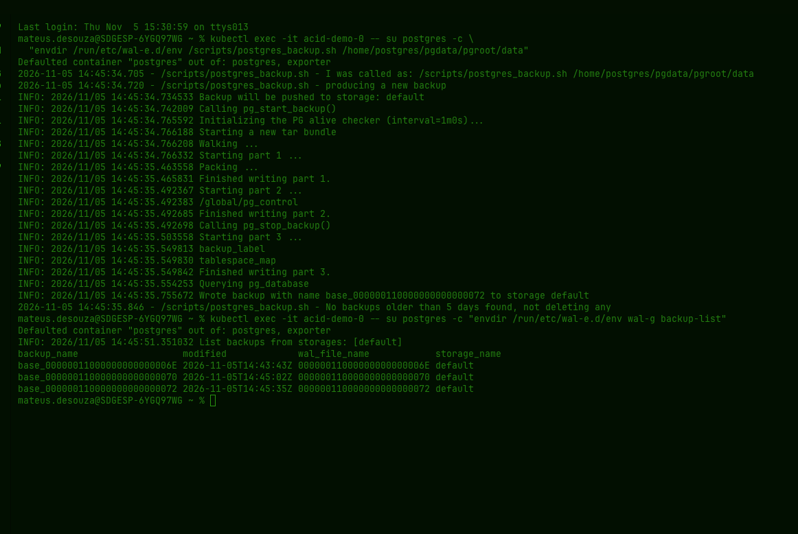

## Backups and point-in-time recovery

- The main tool responsible for the backups and recovery is the WAL-G, a tool written in GO btw!! This open source backup tool is deployed together with the Spilo image.
- WAL-G does a full copy of the database as a backup to some storage account - in this example we will deploy a local s3 store using MinIO and will see how to use the Zalando Operator to change the default object storage to save our backup.

```bash
kubectl create deployment minio --image=docker.io/pgsty/silo:RELEASE.2026-10-26T00-00-00Z -- \
  silo server /data --console-address :9001
kubectl set env deploy/minio MINIO_ROOT_USER=minioadmin MINIO_ROOT_PASSWORD=minioadmin
kubectl get svc minio || kubectl expose deploy/minio --port 9000

kubectl get pods -l app=minio -w #check if the pod is up
kubectl exec deploy/minio -- sh -c \
  'mcli alias set local http://localhost:9000 minioadmin minioadmin && mcli mb local/pg-backups && mcli ls local'
```
- 

- Now for the simplicity of this lab I will use a hardcoded configmap to set the new environment variables for all the pod of the deployment. We need to configure the SPILO images to point to the recent created s3 now.
- New config map is: zalando-postgres-operator-lab/lab-manifests/pod-env.yaml

```bash
kubectl apply -f pod-env.yaml
helm upgrade postgres-operator ./charts/postgres-operator -n postgres-operator \
  --reuse-values \
  --set configKubernetes.pod_environment_configmap=default/pod-env-overrides \
  --set configAwsOrGcp.wal_s3_bucket=pg-backups
```

- Here we can see the operator rolling the pods in real time: 

```bash
kubectl exec -it acid-demo-0 -- su postgres -c \
  "envdir /run/etc/wal-e.d/env /scripts/postgres_backup.sh /home/postgres/pgdata/pgroot/data"
kubectl exec -it acid-demo-0 -- su postgres -c "envdir /run/etc/wal-e.d/env wal-g backup-list"
```

- Now we can then list the backups available: 

- With the timestamp and the uid of the cluster we can then roll back from the backups saved and restore a previous database state!
