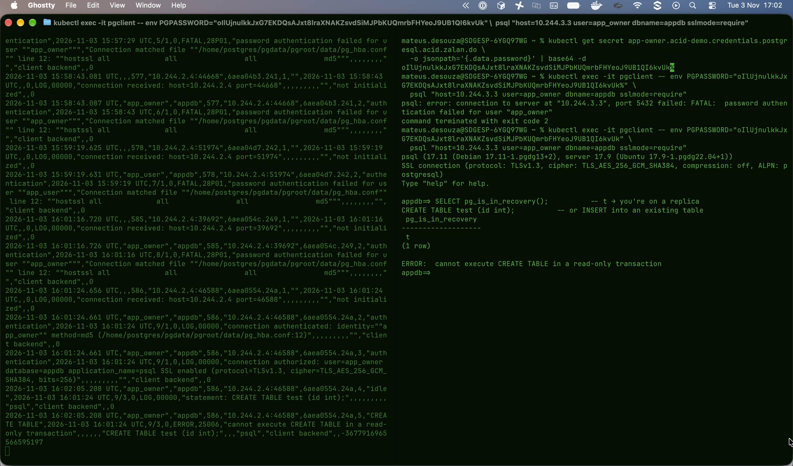
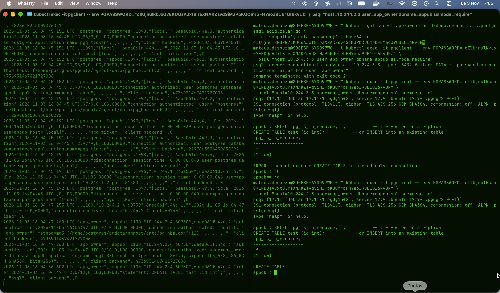

## Experiment - break a pod and see patroni working

- Lets execute a first experiment to see how patroni works under the hood to promote a new replica as the new master.
- First we need to create a client pod with --sleep infinity just to use the psql commands.

```bash
kubectl run pgclient --image=postgres:17 --restart=Never -- sleep infinity
```

- Take the password from the db by reading and decoding the base64 secret value from the kubernetes secrets:

```bash
PGPASS=$(kubectl get secret postgres.acid-demo.credentials.postgresql.acid.zalan.do \
-o jsonpath='{.data.password}' | base64 -d)
```

- From inside the cluster start an interactive psql session so that we can talk to the db:

```bash
kubectl exec -it pgclient -- env PGPASSWORD="$PGPASS" \
psql "host=acid-demo user=postgres dbname=appdb sslmode=require"
```

### Check read-only in replica vs read and write in master

- First open the logs of the replica and try to create a new table from the pgclient.
Follow the result in 

- Execute the same thing in the master.
Follow the result in 

With this and the logs we can see that Patroni keep the master as the source for writing and the replicas are as read only.
During the execution of those tests and following the logs fromt the operator I could confirm that every 30 min the operator check the state of the deployment against the k8s api and patroni is the one responsible for the HA, where the operator also consults the Patroni API.