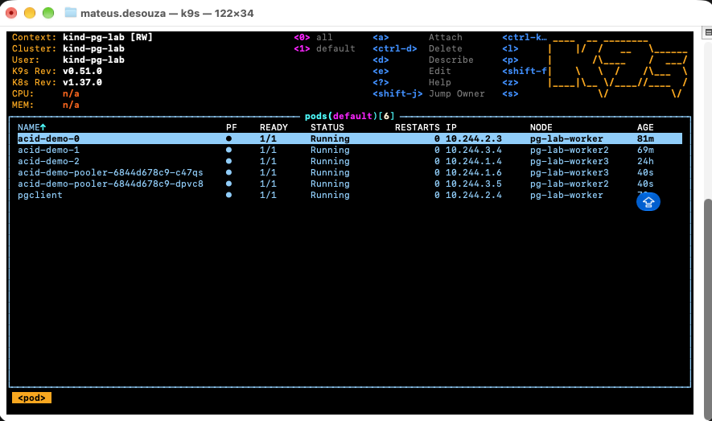
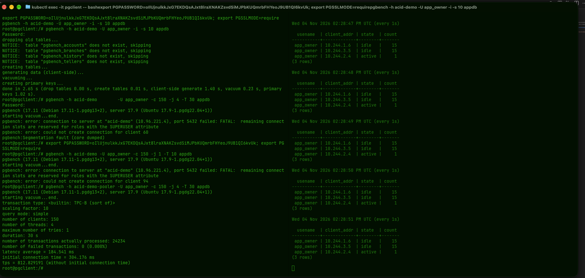

## PGBouncer

- In this section I will patch the deployment and activate the pooler

```bash
kubectl patch postgresql acid-demo --type merge \
  -p '{"spec":{"enableConnectionPooler":true}}'
kubectl get deploy,svc | grep pooler
```




- For this we will execute a load using pgbench and see the difference of having the pooler in transaction mode or in session mode.
- Initilize pgbench with the scale factor of 10.
  
```bash
kubectl exec -it pgclient -- bash
export PGPASSWORD=xxxxx; export PGSSLMODE=require
pgbench -h acid-demo -U app_owner -i -s 10 appdb
```

- Keep a second window to see the pgbench writing records.

```bash
kubectl exec -it pgclient -- env PGPASSWORD="xxxxx" \
  psql "host=acid-demo user=app_owner dbname=postgres sslmode=require"
```
```sql
SELECT usename, client_addr, state, count(*)
FROM pg_stat_activity
WHERE backend_type = 'client backend'
GROUP BY 1, 2, 3
ORDER BY 4 DESC;
\watch 1
```

- Here we can see the result of having 150 with the max_connections as 100: 

- In any moment as we can see the postgres is seeing connections coming from our client, but rather from the pooler.
- By the image we can see that we have 30 server connections divided between the two poolers with 15 each. Pgbench send 150 client connections and the poolers handles them 15 by 15 each.
- Other important point to mention is about the mode used - transaction. This allows to each client send a commit and free the connection letting it free for the next one. In the case of the session mode, the connection would be locked in the client until the whole process finishes and the client disconect from the open connection in the pool.
