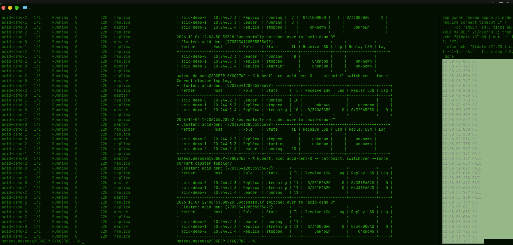
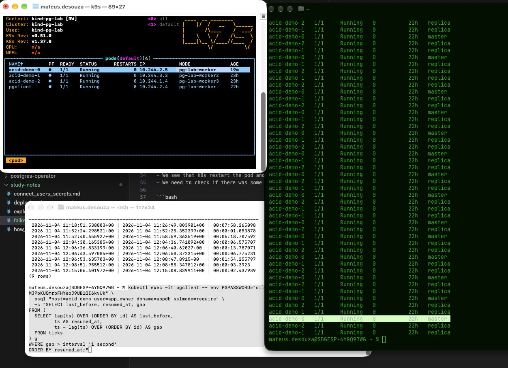
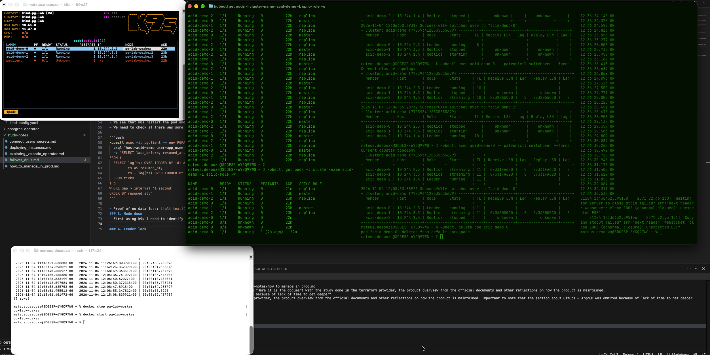
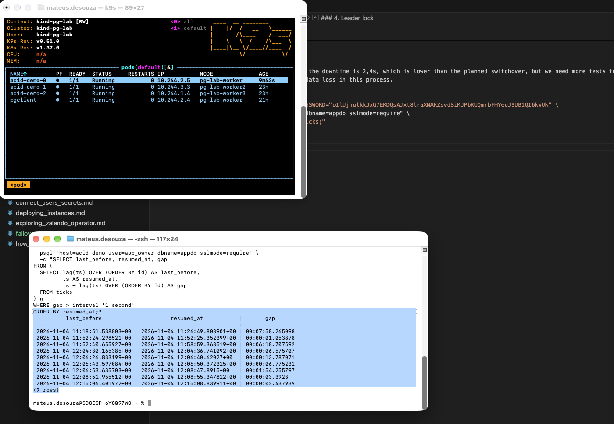

## Failover

- In the case of a cloud provider with a DBaaS, we probably need to give our customers an SLA of our services. As we need to fulfill this promise otherwise we can have fines, it is important to know the time between the primary instance fails and the time it patroni will need to assign the new master. The problem is, imagine that a client using the DB tries to write data in the moment the master is down and patroni doesnt have the time yet to assign a new master. In that moment we need to think in 2 things:
  - Does the application of our costumer has a retry?
  - When the new master will be available again, the commit during downtime would be lost?
- In order to answer those questions we can then check the downtime in this homelab.

- Execute the following query in the pgclient.
  
```bash
  kubectl exec -it pgclient -- env PGPASSWORD="xxxxx" \
  psql "host=10.244.2.3 user=app_owner dbname=appdb sslmode=require" \
  -c "CREATE TABLE ticks (id serial, ts timestamptz default now());"
```

- Create the loop once the table was created in the previous step.

```bash
kubectl exec -it pgclient -- bash -c 'export PGPASSWORD='"xxxxx"'; while true; do
  if psql "host=acid-demo user=app_owner dbname=appdb sslmode=require connect_timeout=1" \
     -qc "INSERT INTO ticks DEFAULT VALUES" 2>/dev/null; then echo "$(date +%T.%N | cut -c1-12) OK";
  else echo "$(date +%T.%N | cut -c1-12) FAIL"; fi; sleep 0.2; done'
```

- Monitore the spilo role from the pods and see how they do the failover.

```bash
kubectl get pods -l cluster-name=acid-demo -L spilo-role -w
```

### 1. Planned switchover
- I conclude that with a planned switchover the pods dont restart and the patroni handles everything. There is no data loss and we can see the HA working.
- 3,4s seconds.


last OK    12:08:51.957
first FAIL 12:08:52.171
last FAIL  12:08:55.128
first OK   12:08:55.349   → ~3.4 s

### 2. Primary pod deleted

- Now the second drill is to check the time that the operator needs to schedule a new pod once we delete the master.
  
```bash
kubectl delete pod <current master>
```

last OK    12:15:06.403
first FAIL 12:15:06.634
last FAIL  12:15:08.597
first OK   12:15:08.843   → ~2.4 s

- We see that k8s restart the pod and the downtime is 2,4s, which is lower than the planned switchover, but we need more tests to see how accurate this time is.
- We need to check if there was some data loss in this process.
```bash
kubectl exec -it pgclient -- env PGPASSWORD="xxxxx" \
  psql "host=acid-demo user=app_owner dbname=appdb sslmode=require" \
  -c "SELECT last_before, resumed_at, gap
FROM (
  SELECT lag(ts) OVER (ORDER BY id) AS last_before,
         ts AS resumed_at,
         ts - lag(ts) OVER (ORDER BY id) AS gap
  FROM ticks
) g
WHERE gap > interval '1 second'
ORDER BY resumed_at;"
```

- Proof of no data loss: 
### 3. Node down
- First using k9s I need to identify which is the node who is running the primary: 
- By deleting the wrong node, I put down the client so I lost my monitoring of the system.... this was a good learning 
- This was by far the longest downtime  -> 35.7 s
  
            last_before          |          resumed_at           |       gap       
-------------------------------+-------------------------------+-----------------
 2026-11-04 11:18:51.538803+00 | 2026-11-04 11:26:49.803901+00 | 00:07:58.265098
 2026-11-04 11:52:24.298521+00 | 2026-11-04 11:52:25.352399+00 | 00:00:01.053878
 2026-11-04 11:52:40.655927+00 | 2026-11-04 11:58:59.363519+00 | 00:06:18.707592
 2026-11-04 12:04:30.165385+00 | 2026-11-04 12:04:36.741092+00 | 00:00:06.575707
 2026-11-04 12:06:26.833199+00 | 2026-11-04 12:06:40.62027+00  | 00:00:13.787071
 2026-11-04 12:06:43.597084+00 | 2026-11-04 12:06:50.372315+00 | 00:00:06.775231
 2026-11-04 12:06:53.635703+00 | 2026-11-04 12:08:47.8915+00   | 00:01:54.255797
 2026-11-04 12:08:51.955512+00 | 2026-11-04 12:08:55.347812+00 | 00:00:03.3923
 2026-11-04 12:15:06.401972+00 | 2026-11-04 12:15:08.839911+00 | 00:00:02.437939
 2026-11-04 12:36:32.531203+00 | 2026-11-04 12:43:18.053135+00 | 00:06:45.521932
 2026-11-04 12:43:51.205828+00 | 2026-11-04 12:44:12.853458+00 | 00:00:21.64763
 2026-11-04 12:44:21.01296+00  | 2026-11-04 12:44:56.696554+00 | 00:00:35.683594
 2026-11-04 12:44:56.924239+00 | 2026-11-04 12:45:00.822372+00 | 00:00:03.898133
 2026-11-04 12:45:00.822372+00 | 2026-11-04 12:45:02.281045+00 | 00:00:01.458673
 2026-11-04 12:45:02.281045+00 | 2026-11-04 12:45:07.417894+00 | 00:00:05.136849

 - 30 s TTL + detection + promotion ≈ 36 s.
  
 - An Node failure with async replication can lose the last commits and is a risk for data loss ultil patroni demotes the primary.
 
### 4. Leader lock

```bash
kubectl get cm acid-demo-leader -o yaml

apiVersion: v1
kind: ConfigMap
metadata:
  annotations:
    acquireTime: "2026-11-04T12:44:51.471995+00:00"
    leader: acid-demo-2
    optime: "893397304"
    renewTime: "2026-11-04T12:56:52.573058+00:00"
    retain_slots: '["acid_demo_0", "acid_demo_1", "acid_demo_2"]'
    slots: '{"acid_demo_0":893397304,"acid_demo_1":893397304,"acid_demo_2":893397304}'
    transitions: "13"
    ttl: "30"
  creationTimestamp: "2026-11-03T13:19:04Z"
  labels:
    application: spilo
    cluster-name: acid-demo
  name: acid-demo-leader
  namespace: default
  resourceVersion: "229861"
  uid: e17d1a7e-9866-49ca-b882-e4caf376c4c0

  ```

- With this we can confirm the default TTL and the number of times that the leader was promoted from another pod - 13.