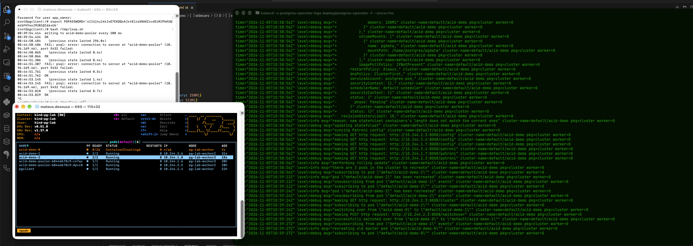
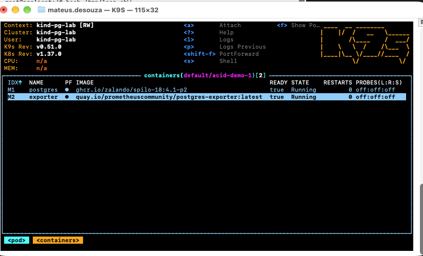
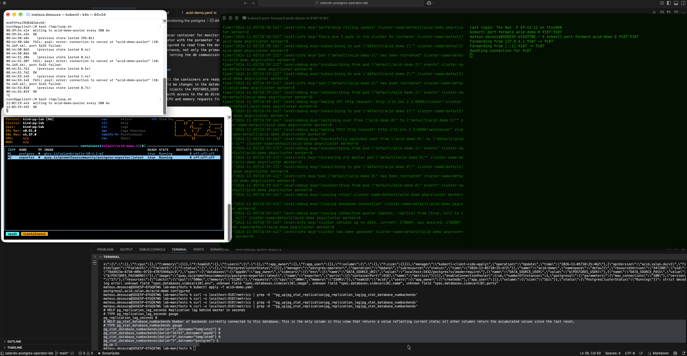

## Monitoring the postgres

- The operator treats the sidecar container for monitoring as an extra container in each pod.
- By default we have the operator with the parameter 'enable_sidecars:True'. This means that every pod will contains 2 containers: 1 with the postgres image and another by the side with the exporter to receive the metrics from the db.
- The sidecar is already configured to read from the default port of the Postgres - 5432.
- We have one exporter per instance, not only the primary.
- In case we want, instead of letting the db communicate with the sidecar via TCP, we can activate the 'share_pgsocket_with_sidecars' so that the exporter will use the same socket directory (this is false by default in the operator - probably to prioritize isolation in the network communiction".

### Consequences of the sidecar

-  A pod is ready only when all the containers are ready - if there will be some crash in the exporter, this would fail the whole pod - this could cause a fail in the whole database - because of the exporter.
-  Changes in the sidecar would be changes in the database and need to schedule a rollout - as it would be an update in the db itself. Should be prepare for a switchover and waves of changes in all instances because of the deployment - we already calculate this downtime.
-  The operator automatically injects the POSTGRES_USER into the exporter, which gives more permissions that the exporter would need - this is a vunerability because if the attacker has access to the exporter but not to the db he could cause more damage than if he would have a lower permission user with access to the db directly.
-  The sidecar would consume CPU and memory requests from the same pod - this that previously was dedicated only to the db.
  
### What the operator doesnt cover

- The operator doesnt cover the discovery of the metrics from the exporter to a tool as prometheus.


### Experimentation:
- Now knowing how the operator works I will replicate the observability architecture of a real managed Postgres product.
  - Activating the sidecar container to export metrics


- First, do a rolling update in the deployment, forward the port of the primary and check with curl the metrics being exported to the endpoint in that port.
- 

```bash
kubectl apply -f acid-demo.yaml
kubectl port-forward acid-demo-0 9187:9187
curl -s localhost:9187/metrics | grep -E '^pg_up|pg_stat_replication|pg_replication_lag|pg_stat_database_numbackends'
```

- 
- 


- Studying about the architecture of the DBaaS I could see that we have a Prometheus pushing samples a Thanos Receiver so that we have a full monitoring of thousands of instances as each instance has its own prometheus and exporter.