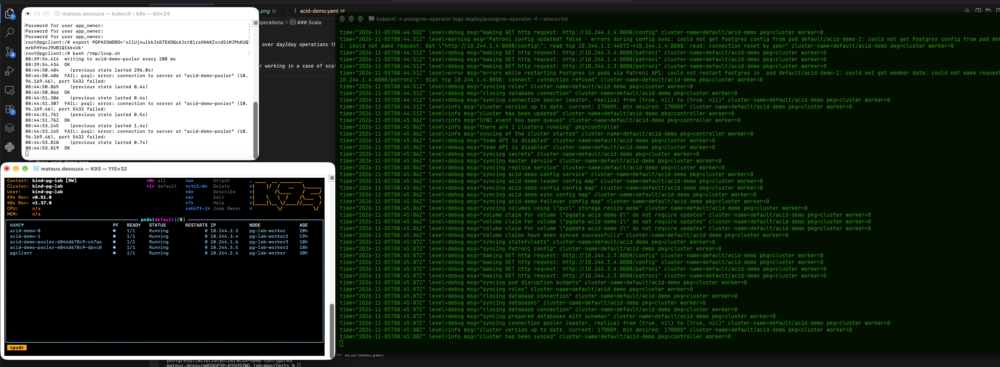
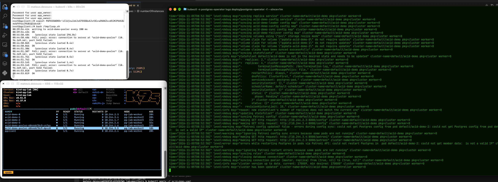

## Operations

- In this section I will work over day2day operations that need some changes in the manifest. Once applied I will check the logs of the operator and see how it responds.

### Scale
- Here we can see the operator working in a case of scalling down the number of instances: 
- By checking the logs we can see how Patroni works under the hood + the migration of the instance: closing connection, migrating roles and so on...
- Also after scalling up we can see how new instances already are visible in different pods in the K9S: 